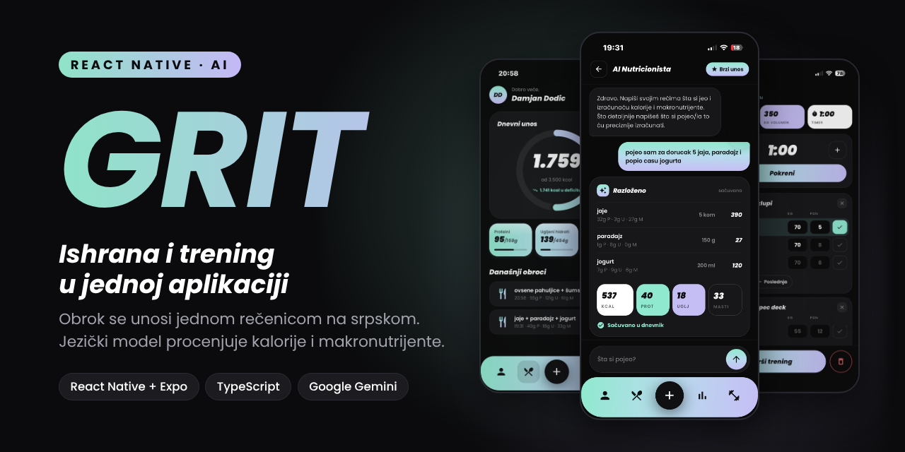

<p align="center">
  
</p>

# GRIT

**Nutrition and training in one app.** Log a meal with a single sentence in Serbian and a language
model estimates its calories and macronutrients. Alongside it: set-by-set workout tracking, a rest
timer, body weight and progress statistics.

A mobile app for iOS and Android, built with React Native (Expo) and TypeScript. The interface is in
Serbian.

## Features

### Nutrition
- **AI meal logging.** Type "pojeo sam 3 jaja i parče hleba" and the app breaks the meal into foods
  with amounts, calories and macros. Every amount can be adjusted before saving (±5 g or one piece).
- **Daily overview.** A calorie ring that also shows how far past the goal you are (surplus or
  deficit), plus cards for protein, carbohydrates and fat.
- **Meal details.** Each food with its amount and macros, and the option to delete the meal.
- **Quick add.** Meals you eat often are saved and logged again with one tap, without calling the model.
- **Day picker.** Log and review previous days as well.

### Training
- Built-in workouts and your own (exercises, sets, reps or seconds).
- **Live workout.** Weight and reps per set, last session's numbers as hints, and the weight carried
  over to the next set.
- **Rest timer.** Adjust in 30 s steps from 0:30 to 5:00, remembers your last length, fills the tile
  while it runs and vibrates when the rest is over.

### Statistics
- Calories, macros, workouts, volume and training time by week, month and year.
- **Strength progress** per exercise, using the estimated one-rep max (Epley).
- **Body weight** with daily entries and a chart over time.

### Profile
- Daily calorie goal from BMR (Mifflin-St Jeor) and activity level, adjustable for a cut or a bulk.
- Macros: protein at 2 g per kg of body weight, fat at 30% of calories, carbohydrates for the rest.
- Light and dark theme.

## Tech stack

| | |
|---|---|
| Platform | React Native 0.88 + Expo SDK 58 |
| Language | TypeScript |
| Navigation | React Navigation (bottom tabs) |
| Storage | AsyncStorage. Everything stays on the device: no server, no account. |
| Meal parsing | Google Gemini with a JSON response schema, plus an offline mock mode |
| Charts | Custom components on `react-native-svg` |
| Icons | SF Symbols on iOS (`expo-symbols`), Material Icons on Android and web |

## Getting started

You need [Node.js](https://nodejs.org) 22.13+ (or 24.3+) and the **Expo Go** app on your phone,
on the version for SDK 58.

```bash
git clone https://github.com/damjan1773/GRIT.git
cd GRIT
npm install
cp .env.example .env
npx expo start
```

Scan the QR code from the terminal with the camera (iOS) or from the Expo Go app (Android). Your
phone and computer need to be on the same network.

### Meal parsing setup (`.env`)

| Variable | Meaning |
|---|---|
| `EXPO_PUBLIC_MEAL_PARSER_PROVIDER` | `gemini` for the real model, `mock` to work offline without a key |
| `EXPO_PUBLIC_MEAL_PARSER_MODEL` | Gemini model, `gemini-3.6-flash` by default |
| `EXPO_PUBLIC_MEAL_PARSER_API_KEY` | Your key from [Google AI Studio](https://aistudio.google.com/apikey) |

> `.env` is not committed. Variables prefixed with `EXPO_PUBLIC_` are bundled into the app, so a key
> set this way is meant for personal use. The web version (branch `web-vercel`) sends meals through a
> server function that keeps the key on the server.

## Project structure

```
src/
  screens/      one file per screen
  components/   shared UI and charts
  context/      app state (profile, meals, workouts, selected day)
  services/     storage and meal parsing
  theme/        colors, themes and styles
  utils/        calculations, dates, statistics
  data/         built-in workouts and statistics metrics
```

## Branches

- `master`: the mobile app.
- `web-vercel`: the web version for Vercel, which can be added to a phone's home screen.

## License

[MIT](LICENSE)
